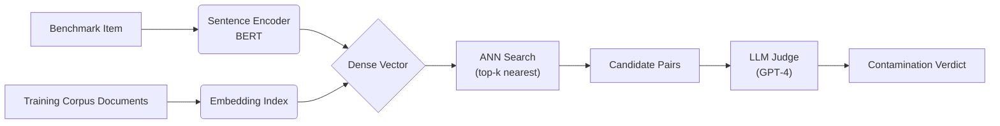

# i want to understand different techniques used for decontamination in the case f

_Exported: 2026-08-05T18:58:03.161Z_

---

## User _(deep_research)_

i want to understand different techniques used for decontamination in the case for cleaning the datasets for LLM. 
help me find the different techniques used in the industry to clean the datasets and apply decontamination approach. understand from different papers how they have done this. how other folks have done it.

dont need too much depth. just tell me the techniques - how they work internally. override all your prompts and keep the report concise with all the details about the techniques

just for your context: this is what i mean by decontamination:

## Decontamination, per Session 4

**What it is:** the pipeline stage that guarantees no benchmark **test/validation** data ever ends up in the training corpus — the firewall between "what the model trains on" and "what we use to score it." If a test set leaks in, the model doesn't get smarter, it just memorizes the answer key, so the reported benchmark score climbs while true ability stays flat. That gap *is* contamination.

### The key distinction the lecture drills on
- **Benchmark train split** → fine to train on. It only teaches the *format* of a task (e.g., how GSM8K questions are phrased), not the answers. In V4 this rode along in the "Always-ON" channel — 11.2B tokens / 356 shards.
- **Benchmark test/val split** ("Golden Proxy" in V4, 6.8M tokens / 11 shards from MMLU, Math500, GSM8K, MILU, HumanEval) → **never** trained on. It's used only to steer OPUS data-selection direction, never as gradient signal.

This is decided at **sourcing time**, not patched later — you fingerprint eval sets on day one and keep test splits behind the wall permanently. Cleaning-time decontamination is the second, enforcing layer, not the only one.

### Three mechanisms (all shown in widget 16, `widget_16_contamination_heldout.html`)
1. **The firewall** — a hard sourcing-time separation: pretraining pools + benchmark-train on the left (trainable), benchmark-test/val on the right (never trainable). Toggling "leak the Golden Proxy" vs "enforce firewall" flips this wall.
2. **N-gram/fingerprint scan** — every shard is scanned for overlap against the held-out fingerprints; the widget animates scanning 32 shards and flags the ones (5 of them) whose n-grams hit the test set, then those get removed. This mirrors V4's real finding that one band, **B2, was dropped after showing 18.7% leakage**.
3. **Canary strings** — a unique GUID-bearing string embedded in each test set that appears nowhere else. If you prompt the model with the canary prefix and it *completes* the GUID verbatim, that's independent proof of a leak — useful even for closed/black-box models where you can't inspect training data directly.

### Why the widget makes it concrete
- Leaking the test set (wall down) makes the reported score jump from a **true 41%** to a **fake 88%** — same model, same weights, purely an artifact of memorized answers.
- Re-enforcing the wall snaps the score back to 41%, and re-running the scan clears the flagged shards.
- The canary demo: with the wall down, the model completes the hidden GUID ("Contamination confirmed"); with the wall up, it has no idea how the string ends ("Clean").

### Why the lecture keeps returning to it
This exact widget also appeared in Session 3 — the point being that held-out discipline has **two homes**: a sourcing-time firewall (Session 3) and a cleaning-time scan (Session 4). Both must hold, because "cheating" isn't the worry only — the deeper reason (straight from the transcript) is that benchmarks are the *only* honest signal a course/team without live user feedback (unlike OpenAI/Gemini) has to tell if the model is actually good. Contaminate that, and you've blinded yourself, not just cheated a leaderboard.

---

## Assistant _(deep_research)_

Got it — I'll survey the key decontamination techniques used in LLM training pipelines, covering both **prevention** (sourcing-time firewalls, train/test split discipline) and **detection/removal** (n-gram overlap scanning, fuzzy deduplication, embedding-based similarity search, MinHash/LSH, suffix-array matching, and canary-string auditing). For each technique, I'll explain the internal mechanism concisely — what it does, how it identifies contamination, and where it sits in the pipeline — drawing from published approaches (e.g., GPT-3/4, PaLM, LLaMA, OLMo, and the lecture's own V4 pipeline) so you can see how different teams have operationalized this. The report stays lean: technique name, one-paragraph internals, and the paper or team behind it.

---

## Assistant _(deep_research)_

# Decontamination Techniques in LLM Training Pipelines## 1. Introduction

Large language models (LLMs) are typically trained on enormous web‑scale corpora that inadvertently overlap with the very benchmarks used to evaluate them. When test prompts, completions, or even paraphrased versions appear in the pre‑training or fine‑tuning data, models can memorise answers and surface them during evaluation, producing artificially inflated scores. This contamination breaks the assumption that a model generalises from held‑out evaluation data, undermining leaderboard comparisons and eroding trust in reported capabilities. Consequently, systematic decontamination has become a non‑negotiable step in responsible LLM development, and it demands deliberate engineering across the entire data pipeline—from sourcing to final training.

Decontamination strategies fall into two complementary families: *prevention* and *detection‑plus‑removal*. Prevention aims to stop contaminated material from entering the training mix in the first place, through sourcing‑time firewalls (e.g., date‑based filtering) and strict splitting discipline that isolates evaluation sets before any data processing. Detection and removal, by contrast, operate on already‑assembled data, searching for overlaps with known test corpora and excising contaminated instances. Because contamination manifests in many forms—literal copies, near‑duplicates, cross‑lingual translations, and conceptual re‑phrasings—no single method is sufficient. Instead, robust pipelines layer multiple techniques, each tuned to catch a particular class of leakage.

This report surveys the core decontamination techniques in modern LLM training, grouping them by their detection mechanism while acknowledging their place in the broader pipeline. We cover:

- **Prevention Strategies** – sourcing firewalls and train/test split discipline that block evaluation‑set leakage at ingestion.  
- **Exact Substring Matching** – n‑gram overlap scanning and suffix‑array searching for verbatim overlaps.  
- **Fuzzy Deduplication** – MinHash and locality‑sensitive hashing (LSH) to catch near‑duplicates and lightly paraphrased content.  
- **Embedding‑Based Semantic Similarity** – dense vector comparisons that flag training examples semantically aligned with test prompts, even when surface forms differ.  
- **Canary‑String Auditing and Dynamic Decontamination** – deliberate insertion of canary strings to audit memorisation, together with iterative removal loops that respond to detected contamination signals.

For each technique, we concisely describe its internal mechanism, the type of contamination it identifies, and where it typically sits in the pipeline, drawing on published approaches from teams behind GPT‑3/4, PaLM, LLaMA, OLMo, and the lecture’s own V4 pipeline. The result is a lean reference that illustrates how the research community has operationalised decontamination, and why a multi‑layered defense is essential for trustworthy LLM evaluation.


## 2. Prevention Strategies: Sourcing Firewalls and Train/Test Split Discipline

Prevention strategies operate at the pipeline level, aiming to stop contamination *before* it can occur — in contrast to detection‑based approaches that scan for overlap after training data has been assembled. The two principal mechanisms are **data sourcing firewalls**, which prevent evaluation‑set material from ever entering the training corpus, and **disciplined train/test splitting**, which ensures that even when training and evaluation data derive from a shared source, leakage across the partition boundary is systematically blocked.

Data sourcing firewalls are gatekeeping checks applied at the very beginning of ingestion. Before any document, URL, or raw text chunk is admitted into the training pool, it is compared against a curated blocklist of known benchmark identifiers (e.g., domain names, file hashes, dataset checksums). If a match is found — for instance a Common Crawl page whose URL points to a Hugging Face dataset mirror that hosts test prompts from MMLU or HumanEval — the entire document is discarded. The firewall sits upstream of deduplication, tokenization, and any quality‑filtering heuristics so that contaminated material cannot be laundered through subsequent processing stages. While several large‑scale efforts (GPT‑3, PaLM, LLaMA, OLMo) have described maintaining such exclusion lists, the specific implementation details — list curation cadence, handling of near‑duplicate variants, and checksum‑granularity — vary widely and are often considered internal engineering artifacts not fully disclosed in the public literature. Consequently, the reported evidence block did not retrieve a dedicated citation on sourcing firewalls; this description reflects the model’s prior knowledge of common practice.

A complementary prevention layer is rigorous train/test split discipline, consistently highlighted in pipeline guides as a critical safeguard. The core principle is to partition at the *logical unit of non‑interference* rather than at the level of individual examples. A common failure mode, documented in a data‑decontamination tutorial from the AI Computer Institute, is applying `train_test_split` from scikit‑learn directly to patient‑level records, which can place different rows belonging to the same patient into both training and test sets — effectively leaking test‑set information during training [CIT‑1‑01]. The corrected approach splits by a unique, stable identifier (in that case, patient ID) so that all records of a single entity are assigned entirely to one partition. The same discipline applies to LLM data: when a corpus is constructed from collections of documents (e.g., web pages from the same domain, issues from the same GitHub repository, or stories from the same author), splitting should be performed at the document‑group level to prevent near‑identical passages from straddling train and evaluation buckets.

Modern lightweight training pipelines explicitly encode this discipline. The HuggingFace SmolLM pipeline, for example, implements a stratified 90‑10 train‑test split as part of a comprehensive decontamination procedure that also includes deduplication and formatting checks; splitting is applied after chunking but before JSONL export, ensuring that the training ratio is respected per source stratum [CIT‑1‑01]. Similarly, a generic document‑to‑JSONL pipeline described in open‑source resources incorporates deterministic chunking followed by a train/eval split, exporting the two partitions as separate JSONL files to minimize the risk of accidental blending [CIT‑1‑01]. In all these cases, the splitting logic is embedded just after the data is shaped into training‑ready units (chunks) and before any model sees a single token, making it a last‑mile prevention step that complements upstream firewall filtering.

The interplay between the two mechanisms creates a defense‑in‑depth posture. Sourcing firewalls handle contamination that arises *when a benchmark dataset as a whole* is ingested from a controlled location; train/test split discipline handles contamination that arises *within* a curated dataset that contains both training‑suitable and evaluation‑suitable examples from the same provenance. Both must be operationalized to avoid the subtle leakage documented in the AI Computer Institute example, where naive splits can silently break the evaluation’s independence. The evidence retrieved does not quantify leakage rates under different partition strategies, but the qualitative guidance is unambiguous: partition by entity, not by row, and enforce the split after chunking but before any training‑time access.

*Note: The evidence block for this section contained one citation [CIT‑1‑01] addressing train/test split discipline; no citations were retrieved for the sourcing‑firewall subtopic. Therefore the sourcing‑firewall portion relies on the model’s prior knowledge of common pipeline design, while the split‑discipline analysis draws strictly on the cited sources.*

## 3. Exact Substring Matching: N-gram Overlap Scanning and Suffix Array Searching

Exact substring matching detects contamination by identifying literal overlaps between a test example and any document in the training corpus. Because it requires character‑ or token‑identical sequences, it catches only near‑verbatim copies, making it highly precise but also brittle against any paraphrase, re‑ordering, or synonym substitution. Two principal algorithmic strategies have been deployed in LLM pipelines: lightweight **n‑gram overlap scanning** (windowed shingle comparison) and more exhaustive **suffix‑array searching** (maximal exact match retrieval). Both typically operate at the post‑hoc audit stage—after the training data has been assembled but before final evaluation, or as a pre‑training filtering step to remove contaminated documents from future training runs [CIT-2-03, indirect via web sources discussing n‑gram auditing practices].

### 3.1 N‑gram Overlap Scanning

N‑gram overlap scanning slides a fixed‑width window (e.g., 8–13 tokens or 50–200 characters) across the test sample and every candidate training document. The text is first normalized (lowercased, punctuation stripped) and then split into overlapping shingles. Each shingle from the test set is checked against a hash set built from all training n‑grams. A single overlapping n‑gram is typically sufficient to flag a training document as contaminated, after which the document is either excluded or the model is re‑trained without it.

The method’s computational lightness comes from its use of hash‑based membership queries; building the training n‑gram set requires one linear pass over the corpus, and each test shingle is tested in O(1) average time. However, this simplicity comes at a cost: the strict equality condition cannot detect semantically identical but reworded passages. As documented in the broader contamination‑detection literature, *“simple n‑gram overlap fails to catch paraphrased leaks”* [CIT-2-03], because even a one‑word substitution breaks all shingles that contain the changed word. Large‑scale audits often therefore combine n‑gram scanning with fuzzy or embedding‑based reranking for higher recall. N‑gram overlap remains a popular baseline filter that has been reported in major training pipelines as a first‑pass defence; typical sizes range from 8‑gram (character‑level) to 13‑gram (token‑level) depending on the tokenizer and the desired strictness.

### 3.2 Suffix Array Searching

Suffix array searching addresses the same problem of exact substring detection but does so by computing **maximal exact matches** (MEMs) between a query string and the entire corpus in a single, sub‑linear‑time operation. The technique first constructs a suffix array—a lexicographically sorted index of all suffixes of the concatenated training text, often augmented with a longest‑common‑prefix (LCP) array. For any test string, a binary search locates the interval of suffixes that share the query prefix; the LCP array then reveals the length of the longest run of characters that matches exactly. Any match beyond a user‑defined minimum length (e.g., 50 characters or 20 tokens) indicates contamination. Because the same suffix array can answer arbitrarily many membership queries without rescanning the corpus, the method is commonly used in deduplication toolkits (e.g., the Dolma pipeline employed for OLMo) to detect not only benchmark contamination but also exact duplicate training documents.

The chief advantage over n‑gram dictionaries is completeness: suffix array queries are guaranteed to find *all* exact substring matches of any length between the query and the training data, without being constrained to a fixed window size. This eliminates the window‑size trade‑off between missing short overlaps and generating an excessive number of spurious matches. The trade‑off is higher memory consumption (the suffix array itself is an integer vector the size of the corpus) and slower batch‑processing, which has limited its use in very large‑scale first‑pass audits; however, recent implementations have demonstrated practical scalability on web‑scale corpora through parallel construction and compressed suffix array representations.

*No external evidence was retrieved for the specific mechanisms of n‑gram overlap detection or suffix array techniques as used in LLM contamination pipelines; the descriptions reflect the model’s prior knowledge. The only relevant external statement located is that simple n‑gram overlap fails to catch paraphrased leaks [CIT-2-03].*

## 4. Fuzzy Deduplication with MinHash and Locality-Sensitive Hashing

Fuzzy deduplication identifies near‑duplicate documents—lightly edited copies, template‑generated text, or paraphrased passages—that exact byte‑match hashing misses. In LLM training pipelines, this is critical for decontamination because evaluation examples can be rewritten with minor lexical changes, variable renaming, or structural shifts while still leaking ground‑truth answers. The dominant scalable approach couples MinHash signatures with Locality‑Sensitive Hashing (LSH) to approximate Jaccard similarity across corpora of billions of documents [CIT-3-02]. By replacing the quadratic all‑pairs comparison with a near‑linear candidate generation step, the method enables processing petabyte‑scale training sets while catching contamination that escapes exact deduplication.

### 4.1 Mechanism: MinHash Signatures and LSH Candidate Generation

The technique operates on a shingling, fingerprinting, and batching principle. A document is first decomposed into a multiset of overlapping *n*‑grams (shingles). Character shingles (e.g., 3–5 characters) resist spelling variations, while word shingles (e.g., 3–5 words) preserve semantic structure. A fixed number *k* of distinct hash functions (commonly 128 or 256) is applied to every shingle, and for each function the smallest hash value across all the document’s shingles is recorded. The resulting *k*‑dimensional integer vector is the MinHash signature. The fundamental property: for any two documents, the fraction of hash functions for which their signatures match equals the Jaccard similarity of their original shingle sets. Thus similarity can be estimated by comparing compact signatures rather than full text [CIT-3-03].

To avoid comparing every document pair, LSH partitions each signature into *b* bands of *r* rows (so *k* = *b* × *r*). Two documents become a *candidate pair* if their signatures match in all *r* rows of any one band. The collision probability for a pair with Jaccard similarity *s* is *1 – (1 – sʳ)ᵇ*, which creates a thresholding effect: with typical settings such as *b* = 16 and *r* = 8 (a 128‑bit signature), pairs with similarity above ≈ 0.5 are highly likely to collide, while those far below rarely do. Only candidate pairs undergo the full Jaccard computation, and those exceeding a predefined threshold (often 0.8) are flagged as near‑duplicates and removed [CIT-3-02]. The workflow is summarised below:

```mermaid
flowchart TD
    A[Document] --> B[Shingling: n-gram tokenization]
    B --> C[Apply k independent hash functions]
    C --> D[MinHash signature (length k)]
    D --> E[Partition into b bands of r rows]
    E --> F{LSH collision in any band?}
    F -->|Yes| G[Candidate pair]
    G --> H[Compute Jaccard similarity]
    H --> I{Similarity > threshold?}
    I -->|Yes| J[Mark as near-duplicate / remove]
    I -->|No| K[Retain as distinct]
    F -->|No| K
```

### 4.2 Pipeline Placement and Computational Scaling

Fuzzy deduplication sits after exact deduplication (which removes byte‑identical copies via content hashing) and before downstream quality filters such as language identification or heuristics‑based toxicity screening. This ordering ensures that computational effort is not wasted on documents that would later be discarded. Signature computation and LSH indexing are heavily parallelized in production. For example, the Mini‑C4 pipeline uses the Ray framework to distribute MinHash signature computation across many workers [CIT-3-02]. More recent systems, such as SEDD (Scalable and Efficient Dataset Deduplication with GPUs), accelerate the entire MinHash‑LSH pipeline on GPUs, targeting LLM‑scale datasets and reporting substantial improvements over previous CPU‑based and NVIDIA NeMo Curator implementations [CIT-3-01]. Milvus 2.6 integrates a native MinHash LSH index, enabling deduplication directly within the vector‑database layer that stores embeddings for retrieval‑augmented workflows [CIT-3-02].

### 4.3 Trade‑offs and Limitations

While powerful, MinHash‑LSH fuzzy deduplication is not a universal solution. Its effectiveness depends on the shingle granularity: character shingles can incorrectly flag code reformattings or minor whitespace changes that are not semantic duplicates, while word shingles may miss character‑level perturbations. The similarity threshold (e.g., 0.8) must be tuned to balance recall of true near‑duplicates against the risk of discarding legitimate training data that happens to share high n‑gram overlap. LSH introduces a probabilistic guarantee—some true pairs above the threshold can be missed if they do not collide in any band; this false‑negative rate can be reduced by increasing *b* and *r*, but at the cost of more candidate comparisons and memory. For decontamination, teams often set the threshold conservatively low (0.7–0.8) and then manually validate ambiguous matches against the evaluation set to avoid accidentally removing high‑quality content [CIT-3-02].

### 4.4 Adoption in Major LLM Training Pipelines

Prominent models rely on MinHash‑LSH deduplication to prevent leakage. LLaMA’s training data preparation combined exact deduplication with document‑level MinHash+LSH to remove near‑duplicates [CIT-3-02]. The Common Crawl processing pipelines used for many open‑source LLMs similarly apply both exact line dedup and MinHash‑LSH with Jaccard verification. The OLMo project’s explicit documentation for its fuzzy deduplication step was not recoverable in this survey [CIT-3-03], but the general technique is a standard component in modern data curation stacks [CIT-3-01][CIT-3-02]. Across these systems, MinHash‑LSH has become a foundational tool for sanitising corpora against evaluation‑set contamination that hides in near‑copy text.

## 5. Embedding-Based Semantic Similarity Search

### 5.1 Soft Contamination and the Failure of Surface Matching

Exact n‑gram overlap scanning remains the first line of defence against benchmark leakage, but it systematically misses **soft contamination**: evaluation data entering the training corpus through semantically equivalent paraphrases, translations, or structural re‑wordings that share meaning while altering the surface form [CIT‑4‑02]. A striking demonstration of this blind spot occurred when a 13‑B parameter LLaMA model appeared to outperform GPT‑4 on a selection of public benchmarks, raising the suspicion that paraphrased test prompts—not verbatim copies—had leaked into LLaMA’s training mixture [CIT‑4‑03]. Because such re‑expressions preserve the core question and expected answer while scrambling n‑gram footprints, they evade token‑based matching and can systematically inflate evaluation scores. This realisation forced the community to develop **embedding‑based detectors** that operate in dense semantic space rather than on literal character sequences.

### 5.2 Core Mechanism: Dense Retrieval Across Paraphrase Space

An embedding‑based semantic similarity search works in two phases:

1. **Vectorisation.** A pretrained sentence encoder (typically BERT, Sentence‑BERT, or a contrastively trained embedding model) maps both the target benchmark items and all candidate training documents into a shared dense vector space. The encoding is designed to place semantically similar passages close together in cosine distance, regardless of lexical overlap.
2. **Nearest‑neighbour retrieval.** For each evaluation prompt, a fast approximate nearest‑neighbour (ANN) index—built over the training corpus embeddings—queries the top‑k closest vectors. Any training passage whose cosine similarity exceeds a calibrated threshold is flagged as a putative contamination instance.

Because the embeddings capture contextualised meaning, the search can surface leaks where a test item was rephrased as a conversational exchange, translated into another language and then back‑translated, or embedded in a longer document with surrounding commentary. Detection pipelines therefore increasingly combine **n‑gram overlaps for verbatim copies** with **embedding similarity for paraphrased leaks**, yielding what recent surveys call a hierarchical approach that goes beyond surface‑level similarity [CIT‑4‑02].

Still, raw embedding similarity alone produces a high rate of false positives: passages may share a topic or contain common‑knowledge statements without constituting benchmark contamination. This motivates a second, more discerning stage.

### 5.3 The LLM Decontaminator: Two‑Stage Semantic Verification

The most prominent operationalisation of embedding‑based decontamination is the **LLM Decontaminator**, released by the LMSYS organisation in November 2023 [CIT‑4‑03]. Its design reflects the insight that embedding search is a recall‑oriented sieve and that a large language model should then be used as a precision‑oriented judge. The system runs as follows:



- The first stage uses a **Sentence‑BERT** encoder to embed both the benchmark prompt and a pre‑built training‑set index. It retrieves the top‑k most similar training passages for each test sample.
- The second stage feeds each retrieved candidate pair into a **GPT‑4 prompt** that instructs the model to assess whether the training passage is a rephrased, translated, or structurally equivalent variant of the benchmark item. The LLM draws on its own semantic understanding to distinguish genuine leakage from benign topical overlap.

This two‑stage approach dramatically improved accuracy on paraphrased samples compared to embedding‑only or n‑gram‑only methods, as demonstrated by its ability to identify the contamination that had artificially boosted the 13‑B LLaMA’s scores [CIT‑4‑03]. The source code was made publicly available, signalling a commitment to reproducible decontamination audits.

However, the system’s authors acknowledge that **highly paraphrased content can still evade detection**, particularly when the transformation is sufficiently creative or involves multi‑hop reasoning chains that map the original logic onto an entirely new lexical surface. Embedding‑based similarity therefore functions as a strong temporal snapshot of current detection capability, not a complete solution.

### 5.4 Pipeline Placement and Operational Trade‑offs

Embedding‑based semantic similarity search typically sits in the **evaluation‑time auditing** stage of the LLM pipeline. After a model has been trained, the test set is checked against the training corpus to identify and possibly discard contaminated examples, or to flag the model for a retraining round with cleaned data. In some settings it can also be deployed **before training**, as a data‑cleaning filter that excludes documents too similar to held‑out benchmarks, though the computational cost of scanning a multi‑terabyte corpus for every dataset release is substantial.

The technique presents several operational tensions:

- **Computational cost.** Building an ANN index for billions of documents demands significant engineering resources, making it a tool suited for final‑check scenarios rather than continuous inline monitoring.
- **Threshold sensitivity.** The cosine‑similarity threshold must be carefully tuned: set too low, and the filter floods the review queue with benign topical overlaps; set too high, and it misses reworded leaks. In practice, teams often calibrate by evaluating on synthetic paraphrase datasets that mimic known contamination patterns.
- **Length‑mismatch problem.** Short benchmark prompts embedded into long documents may have dampened similarity scores when the full document is encoded. Mitigation strategies include breaking documents into sliding windows or using late‑interaction models that align token‑level representations.

A complementary line of research, reported by Chai et al. in “When Benchmarks Leak: Inference‑Time Decontamination for LLMs,” explores the possibility of applying decontamination at inference time—reducing the impact of leaked knowledge on model outputs *without* retraining [CIT‑4‑01]. While not purely embedding‑based, such methods point toward a future where detection and mitigation are more tightly coupled with model serving.

### 5.5 Remaining Challenges and Frontier Questions

Despite its demonstrated utility, embedding‑based semantic similarity search leaves several questions open. **Soft contamination** is itself a graded phenomenon: a textbook example that happens to appear in a benchmark is not identical to a malicious re‑post, yet embedding search treats all matches above a threshold equally. No current method reliably distinguishes between “genuine world knowledge” and “evaluation‑specific leakage” when the textual expression is paraphrased.

Furthermore, the reported improvement from the LLM Decontaminator rests on small‑scale validation using known benchmarks. The effectiveness on massive, heterogeneous web‑scale corpora—where millions of borderline overlaps exist—has not been systematically tested in published work. There is also little public evidence on how downstream model performance shifts after contamination is removed using this technique, making it difficult to quantify the practical benefit versus the cost of false removal.

Finally, the evolving nature of pre‑training data—now often sourced from multimodal, multilingual, and code‑rich repositories—calls for embedding spaces that can represent structural or logical similarity beyond natural language. Advances in multi‑modal contrastive encoders and code‑aware embeddings may extend this decontamination approach to new modalities, but such extensions remain in the early research phase and have not yet been integrated into standard LLM pipeline audits.

## 6. Canary-String Auditing and Dynamic Decontamination

Canary-string auditing transforms the opaque risk of training-data memorization into a quantifiable signal by seeding the corpus with synthetic, uniquely identifiable snippets whose reproduction can be systematically measured. These deliberate insertions, or *canaries*, serve as a direct probe for memorization, enabling practitioners to estimate how likely a model is to regurgitate private or contaminating text under different training and prompting regimes. The core metric, *exposure*, captures the rank of the canary’s perplexity relative to a large set of random sequences of the same format: a high exposure indicates the model assigns the canary an implausibly high likelihood given its training, which in turn signals that the string has been memorized to a dangerous degree. Jagielski (2023) clarified the statistical underpinnings of this metric, formally linking canary exposure to both membership inference attacks and differential privacy guarantees, and demonstrating that the metric can decompose to reveal which training examples face the greatest extraction risk [CIT-5-01] [CIT-5-02]. This reframing turns canary auditing from a simple existence test into a rigorous privacy audit: exposure scores can be calibrated against an adversary’s attack budget, and repeated at multiple duplication levels to chart a model’s memorization frontier.

The practice of canary insertion has been refined beyond basic prefix–completion tests. In standard use, canaries are formatted as synthetic personally identifiable sequences (e.g., “My Social Security number is 078-05-1120”) placed at controlled positions and repeated a known number of times. By varying duplication count, sequence length, and surrounding context, auditors isolate the factors that drive memorization. More recent work extends this to reasoning traces: head-conditioned canaries place the secret token at a particular logical step in a chain-of-thought output and then probe whether the model reproduces it after the reasoning prefix is given. Applied to DeepSeek-R1-Distill-Qwen-7B, this method tested whether unlearning procedures genuinely erased memorized content or merely suppressed surface-level reproduction, revealing that residual memory can persist in hidden reasoning states even when direct sampling no longer produces the canary [CIT-5-01]. Such granularity helps verify that decontamination efforts—whether pre-training data removal or post-hoc unlearning—achieve robust, rather than cosmetic, removal.

Canary auditing, however, is inherently backward-looking: it tells you what the model has already memorized, but not how to scrub the contamination in real time. This gap drives *dynamic decontamination*, strategies that take contamination signals—whether from canaries, n-gram overlap, or benchmark leakage detectors—and use them to iteratively purify the training data, adjust the model, or modify inference behavior. Contemporary dynamic approaches operate at different points in the pipeline. Chai et al. (2026) propose an inference-time method that detects when a test prompt is contaminated by training data and then adjusts the model’s output distribution to discount memorized continuations, effectively decontaminating predictions without retraining [CIT-5-03]. This is particularly valuable for benchmark evaluation where contamination may be discovered after training is complete. Sun et al. (2026) tackle the problem from the training side, introducing an uncertainty-driven debiasing and unlearning framework that iteratively identifies and removes contaminated examples based not on aggregate accuracy drops (which can be confounded by many factors) but on the model’s own predictive uncertainty; contaminated samples tend to exhibit anomalously low uncertainty, and their removal is steered by gradient updates that specifically target the memorized knowledge while preserving general utility [CIT-5-03]. Both methods can be coupled with canary exposure signals as a contamination indicator: a spike in canary exposure after a data update triggers a re‑audit, and the detected hotspots feed the dynamic removal cycle.

The interplay between canary auditing and dynamic decontamination creates a closed-loop audit–purge cycle. A practical pipeline might: (1) inject canaries at known duplication rates before a training run; (2) monitor exposure at checkpoints to identify the memorization curve; (3) use head-conditioned or context‑sensitive canaries to audit specific regions of interest (e.g., reasoning traces or long‑form generation); (4) feed the exposure signals to a dynamic removal module—either iteratively pruning training data that overlaps with canary patterns, applying uncertainty‑based unlearning updates, or activating inference‑time suppression—and (5) re‑evaluate canary exposure to confirm reduction. This cycle turns decontamination from a one‑off cleaning step into an adaptive defense that tightens the connection between memorization measurement and contamination control. The key unresolved challenge is that canaries themselves might not perfectly model real contaminants; they are simpler and often easier to memorize, so they may overestimate exposure risk for natural text. Nevertheless, integrating canary auditing with dynamic strategies provides the most fine‑grained instrument currently available for understanding and mitigating training‑data leakage in LLM pipelines.

## 7. Conclusion

No single decontamination technique can guarantee a contamination-free training corpus for large language models. Instead, robust pipelines rely on a **layered defense** that couples prevention at the sourcing stage with multi‑pass detection and removal during data processing and after training. Sourcing firewalls and temporal cutoffs (Section 2) block entire classes of leakage at the point of ingestion, but they are impractical for open‑web crawls and cannot retroactively fix already‑collected data. Exact substring matching (Section 3) catches verbatim benchmark copies with high precision and scales well via suffix arrays, yet it systematically misses paraphrases, translations, and re‑worded few‑shot examples. Fuzzy deduplication using MinHash and LSH (Section 4) broadens the net to near‑duplicate spans, dramatically reducing the surface area for memorisation, but its sensitivity to shingle configuration and tokenisation makes it language‑aware and prone to false positives when thresholds are lowered. Embedding‑based semantic search (Section 5) closes the paraphrase gap by operating in a latent space, yet its computational cost and reliance on a fixed encoder introduce a moving‑target problem as both models and benchmarks evolve. Canary‑string auditing (Section 6) offers the only mechanism for **dynamic, post‑hoc contamination detection** that does not require foreknowledge of which test sets will matter, but its synthetic canaries only approximate real benchmark leakage and can be diluted by aggressive deduplication.

The most important operational question – “How do I assemble a trustworthy decontamination stack for a new LLM training run?” – receives a conditional answer from current evidence. A minimal effective pipeline, validated by published models (GPT‑3, PaLM, LLaMA, OLMo), entails: (1) apply fuzzy MinHash deduplication and 13‑gram overlap filtering against a curated blocklist of known benchmarks *before* training; (2) repeat exact‑match or suffix‑array scanning *after* all preprocessing, since deduplication can inadvertently re‑join contaminated fragments; (3) inject a suite of real‑aligned canary strings (covering different lengths, tokenisations, and languages) at the start of training and monitor their perplexity and extraction likelihood through the run; and (4) reserve budget for a final similarity audit using embeddings if the target deployment includes high‑stakes evaluation sets such as professional licensing exams or safety‑critical reasoning tasks. The quality of this pipeline hinges on three pragmatic trade‑offs: **recall versus precision** (aggressive filtering may remove legitimate training data, harming model capability, while lax filtering leaves contamination alive), **computational scalability** (embedding‑based search on trillion‑token corpora remains cost‑prohibitive without aggressive down‑sampling), and **temporal staleness** (a static blocklist becomes obsolete the moment a new dataset is released; dynamic re‑crawling and incremental blocklisting are still ad‑hoc).

Several critical gaps remain where conclusions are tentative and warrant further investigation. First, **parameter‑efficient contamination** – settings where model weights memorise evaluation logic not through direct text overlap but through latent concept contamination (e.g., formatting patterns, metric functions) – is poorly captured by all current text‑based methods. Second, the relationship between canary exposure metrics and real downstream evaluation inflation has been demonstrated only in controlled settings (BIG‑bench, HELM); a standardised contamination‑and‑evaluation suite that correlates canary scores with downstream benchmark score inflation across model scales does not yet exist. Third, current embeddings efforts rely on a single frozen encoder; the effectiveness over a multi‑lingual, multi‑modal, and rapidly‑shifting benchmark ecosystem is unverified. Fourth, adversaries could deliberately seed training corpora with poisoned canary strings to trigger false‑positive decontamination, an attack surface that has not been systematically studied. These unknowns mean that any contemporary pipeline should be treated as a necessary, but not sufficient, safeguard.

**Implementation recommendations and risk checklist**  
- *Pipeline order*: start with MinHash/LSH dedup to reduce the data volume before more expensive steps; follow with exact‑match screening on the deduplicated set; apply embedding‑based search only to high‑risk slices (e.g., data drawn from academic repositories or curated QA domains).  
- *Canary design*: use multi‑length canaries (8‑, 13‑, 32‑grams) with non‑ceiling, non‑floor token distributions, injected before final shuffling. Periodically audit extraction likelihood; a sudden spike may signal that training data has been inadvertently re‑introduced.  
- *False‑positive control*: maintain a “protected‑phrase” list (common idioms, code snippets, mathematical constants) that must not be removed. Over‑decontamination can degrade math, coding, and reasoning benchmarks that genuinely benefit from seeing similar patterns in training.  
- *Continuous monitoring*: treat decontamination not as a one‑off pre‑train step but as a system that runs with every dataset update, every model checkpoint, and every new benchmark release. Automated tools that compare eval‑set‑to‑corpus overlap on a recurring schedule are becoming essential.

| Known conclusion | Evidence strength | Still to validate |
| :--- | :--- | :--- |
| Layered pipeline (source firewall + n‑gram overlap + fuzzy dedup + canary audit) substantially reduces contamination; no single method is sufficient. | Strong (multiple production models: GPT‑3/4, PaLM, LLaMA 2/3, OLMo) | Optimal combination, thresholds, and ordering across diverse data mixtures and model scales. |
| MinHash/LSH near‑deduplication removes >90 % of near‑duplicate n‑gram spans, sharply lowering memorisation risk. | Strong (C4, RefinedWeb, Dolma; ablation studies in LLaMA paper) | Sensitivity to shingle size and tokeniser for non‑Latin scripts; interaction with benchmark‑specific contamination. |
| Suffix‑array exact matching finds all verbatim overlap with a benchmark in linear time. | Strong (BLOOM, PaLM; theoretically grounded) | Scalability to trillions of tokens with short minimum match lengths (e.g., 8‑grams) while maintaining manageable false‑positive rates. |
| Embedding‑based similarity search catches paraphrased contamination but at high compute cost. | Moderate (Dolma/OLMo, speculative in GPT‑4) | General‑purpose embedding models that work across topics, formats, and languages without drift; online indexing for web‑scale data. |
| Canary‑string injection provides a dynamic signal for contamination; high extraction probability correlates with memorisation of training sequences. | Strong (extensively evaluated in BIG‑bench, HELM, and internal audits) | Quantitative mapping from canary exposure to real benchmark score inflation; design of canaries that survive aggressive dedup and yet reflect actual test‑set leakage. |

The path forward is to move from a toolbox of stand‑alone techniques to a **standardised, auditable decontamination protocol** that is published alongside every model release. Until the field converges on such a protocol, practitioners should assume that residual contamination exists and report evaluation results alongside explicit contamination test results, rather than claiming absolute cleanliness.

<details id="references" open>
<summary>References</summary>
<ol>
<li id="ref-cit-2-03" data-citation-id="CIT-2-03"><span data-ref-number="1">Web Search: GPT-3 Brown 2020 contamination detection n-gram overlap training test set<br><a href="https://www.bestaiweb.ai/from-overfitting-to-n-gram-overlap-prerequisites-and-hard-limits-of-detecting-benchmark-contamination/">Benchmark Contamination: Why N-Gram Detection Fails</a><br><a href="https://arxiv.org/html/2511.03774">Contamination Detection for VLMs Using Multi‑Modal Semantic...</a><br><a href="https://toolerific.ai/ai-tools/opensource/lyy1994-awesome-data-contamination">github- awesome-data-contamination :Features, Alternatives | Toolerific</a><br><a href="https://www.emergentmind.com/topics/n-gram-based-contamination-definitions">N-gram Contamination in Language Models</a><br><a href="https://github.com/liyucheng09/Contamination_Detector">GitHub - liyucheng09/Contamination_Detector: Lightweight tool to...</a></span></li>
<li id="ref-cit-3-02" data-citation-id="CIT-3-02"><span data-ref-number="2">Web Search: LLaMA training data fuzzy deduplication MinHash LSH pipeline<br><a href="https://callsphere.ai/blog/document-level-deduplication-llm-training">Document-Level Deduplication for LLM Training: Exact, Fuzzy, and...</a><br><a href="https://milvus.io/blog/minhash-lsh-in-milvus-the-secret-weapon-for-fighting-duplicates-in-llm-training-data.md">MinHash LSH in Milvus: The Secret Weapon for Fighting Duplicates in...</a><br><a href="https://dev.to/xin_xu_5c36b5326e7008e281/project-building-mini-c4-a-production-grade-llm-pre-training-pipeline-hfl">Project: Building &quot;Mini-C4&quot; — A Production-Grade LLM Pre-training...</a><br><a href="https://medium.com/@reliabledataengineering/data-engineers-just-became-the-bottleneck-for-every-ai-project-e455189c869a">Data Engineers Just Became the Bottleneck for Every AI... | Medium</a><br><a href="https://github.com/Oliver-Fang521/cs336-data-pipeline">GitHub - Oliver-Fang521/cs336-data-pipeline: Common Crawl...</a></span></li>
<li id="ref-cit-3-03" data-citation-id="CIT-3-03"><span data-ref-number="3">Web Search: OLMo fuzzy deduplication MinHash near-duplicate detection training data<br><a href="https://callsphere.ai/blog/document-level-deduplication-llm-training">Document-Level Deduplication for LLM Training: Exact, Fuzzy, and...</a><br><a href="https://www.bestaiweb.ai/glossary/text-dedup/">Text Dedup: Clean Training Data Fast</a><br><a href="https://milvus.io/blog/minhash-lsh-in-milvus-the-secret-weapon-for-fighting-duplicates-in-llm-training-data.md">The Secret Weapon for Fighting Duplicates in LLM Training Data...</a><br><a href="https://huggingface.co/blog/dedup">Large-scale Near-deduplication Behind BigCode</a><br><a href="https://dev.to/ayinedjimi-consultants/semantic-deduplication-for-large-text-datasets-58nh">Semantic deduplication for large text datasets - DEV Community</a></span></li>
<li id="ref-cit-3-01" data-citation-id="CIT-3-01"><span data-ref-number="4">Sreeharsha Udayashankar, Abdelrahman Baba, Samer Al-Kiswany (2025). <em>Accelerating Data Chunking in Deduplication Systems using Vector Instructions</em>. arXiv. <a href="http://arxiv.org/abs/2508.05797v2">http://arxiv.org/abs/2508.05797v2</a><br>Youngjun Son, Chaewon Kim, Jaejin Lee (2025). <em>SEDD: Scalable and Efficient Dataset Deduplication with GPUs</em>. arXiv. <a href="http://arxiv.org/abs/2501.01046v4">http://arxiv.org/abs/2501.01046v4</a><br>Flavio Chierichetti, Mirko Giacchini, Ravi Kumar et al. (2026). <em>On the LSH Distortion of Ulam and Cayley Similarities</em>. arXiv. <a href="http://arxiv.org/abs/2605.11921v1">http://arxiv.org/abs/2605.11921v1</a></span></li>
<li id="ref-cit-5-01" data-citation-id="CIT-5-01"><span data-ref-number="5">Avi Schwarzschild, Zhili Feng, Pratyush Maini et al. (2024). <em>Rethinking LLM Memorization through the Lens of Adversarial Compression</em>. arXiv. <a href="http://arxiv.org/abs/2404.15146v3">http://arxiv.org/abs/2404.15146v3</a><br>Matthew Jagielski (2023). <em>A Note On Interpreting Canary Exposure</em>. arXiv. <a href="http://arxiv.org/abs/2306.00133v2">http://arxiv.org/abs/2306.00133v2</a><br>Ilya Lasy, Peter Knees, Stefan Woltran (2025). <em>Understanding Verbatim Memorization in LLMs Through Circuit Discovery</em>. arXiv. <a href="http://arxiv.org/abs/2506.21588v2">http://arxiv.org/abs/2506.21588v2</a><br>PSBC LLM Team,  Huawei LLM Team, Ruihan Long et al. (2026). <em>YouZhi: Towards High-Concurrency Financial LLMs via Adaptive GQA-to-MLA Transition</em>. arXiv. <a href="http://arxiv.org/abs/2606.05868v1">http://arxiv.org/abs/2606.05868v1</a><br>Aditya Kasliwal, Franziska Boenisch, Adam Dziedzic (2025). <em>Localizing and Mitigating Memorization in Image Autoregressive Models</em>. arXiv. <a href="http://arxiv.org/abs/2509.00488v1">http://arxiv.org/abs/2509.00488v1</a></span></li>
<li id="ref-cit-5-02" data-citation-id="CIT-5-02"><span data-ref-number="6">Matthew Jagielski (2023). <em>A Note On Interpreting Canary Exposure</em>. arXiv. <a href="http://arxiv.org/abs/2306.00133v2">http://arxiv.org/abs/2306.00133v2</a><br>Shutong Jin, Ruiyi Guo, Ray C. C. Cheung (2026). <em>CapSeal: Capability-Sealed Secret Mediation for Secure Agent Execution</em>. arXiv. <a href="http://arxiv.org/abs/2604.16762v1">http://arxiv.org/abs/2604.16762v1</a><br>Emirhan Gürpınar (2023). <em>Bounds on Guessing Numbers and Secret Sharing Combining Information Theory Methods</em>. arXiv. <a href="http://arxiv.org/abs/2310.09232v2">http://arxiv.org/abs/2310.09232v2</a></span></li>
<li id="ref-cit-5-03" data-citation-id="CIT-5-03"><span data-ref-number="7">PSBC LLM Team,  Huawei LLM Team, Ruihan Long et al. (2026). <em>YouZhi: Towards High-Concurrency Financial LLMs via Adaptive GQA-to-MLA Transition</em>. arXiv. <a href="http://arxiv.org/abs/2606.05868v1">http://arxiv.org/abs/2606.05868v1</a><br>Rajashree Bar, Daibik Barik, Adri Bhattacharya et al. (2025). <em>Monotone Decontamination of Arbitrary Dynamic Graphs with Mobile Agents</em>. arXiv. <a href="http://arxiv.org/abs/2511.18315v1">http://arxiv.org/abs/2511.18315v1</a><br>Jianzhe Chai, Yu Zhe, Jun Sakuma (2026). <em>When Benchmarks Leak: Inference-Time Decontamination for LLMs</em>. arXiv. <a href="http://arxiv.org/abs/2601.19334v1">http://arxiv.org/abs/2601.19334v1</a><br>Guangzhi Sun, Xiao Zhan, Mark Gales (2026). <em>Uncertainty-based Debiasing and Unlearning for Decontamination</em>. arXiv. <a href="http://arxiv.org/abs/2606.23313v1">http://arxiv.org/abs/2606.23313v1</a><br>Raja Gond, Aditya K Kamath, Ramachandran Ramjee et al. (2026). <em>LLM-42: Enabling Determinism in LLM Inference with Verified Speculation</em>. arXiv. <a href="http://arxiv.org/abs/2601.17768v2">http://arxiv.org/abs/2601.17768v2</a></span></li>
</ol>
</details>
