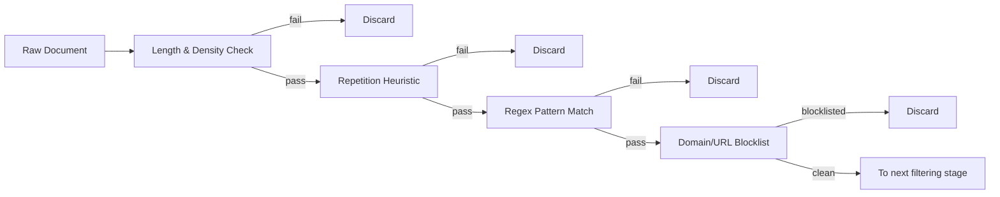
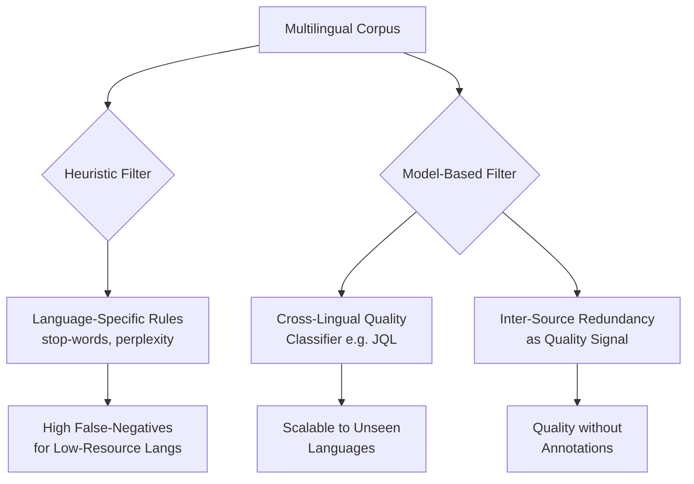

# Quality Filtering Techniques for Training Data Curation## 1. Introduction

The performance of large language models (LLMs) is inextricably tied to the quality of their training data. These models, trained on web-scale corpora containing trillions of tokens, learn not only the structure of language but also the biases, errors, and toxicities embedded in their sources. Raw data from the open internet is a double-edged sword: it provides unparalleled diversity and scale, yet much of it is redundant, nonsensical, machine‑generated spam, or outright harmful. Consequently, the art and science of curating a high‑quality pretraining dataset has emerged as a critical determinant of model utility, safety, and robustness. Quality filtering—the systematic process of identifying and removing undesirable content—thus becomes the foundation upon which downstream alignment and fine‑tuning efforts are built.

Quality filtering is far more than a simple cleanup step; it is a multi‑dimensional optimization that shapes the knowledge boundaries of a model. The filtering pipeline must confront noise (grammatical errors, boilerplate text, code intermixed with prose), toxicity (hate speech, explicit material), factuality (misinformation, contradictory statements), and redundancy (near‑duplicates that waste capacity and risk memorization). Beyond these, it must grapple with the preservation of diverse perspectives and underrepresented domains, because overly aggressive pruning can homogenize the corpus and strip away crucial rare information. The central challenge is therefore not merely to discard “bad” data, but to do so without sacrificing the distributional breadth that imbues LLMs with their remarkable few‑shot reasoning and generalization abilities.

This report examines the layered toolkit of filtering techniques that address these competing goals, moving from fast, interpretable heuristics to data‑driven model‑based judgments and finally to methods that safeguard semantic diversity. We explore how rule‑based first‑pass filters act as a rapid coarse sieve, how lightweight classifiers and perplexity scoring bring a more nuanced, automated evaluation, how semantic deduplication via MinHash and embeddings prevents representation collapse, and how domain‑specific and multilingual contexts challenge off‑the‑shelf solutions. By dissecting each stage, we illuminate not only the mechanisms themselves but also the trade‑offs and design principles that guide the construction of robust data curation pipelines. Readers seeking deeper technical details will find references to seminal papers and open‑source implementations throughout, and a curated list of essential readings is provided at the end of each section.

## 2. The Role of Quality Filtering in Data Curation

Quality filtering is the systematic process of inspecting, scoring, and removing low-quality, toxic, irrelevant, or redundant content from training datasets before they are used to train large language models. The practice has matured into a foundational data-curation pillar not because it yields a pristine corpus, but because it shifts the curation mindset: the primary goal is to **remove noise**, aggressively excising harmful or useless examples, rather than merely seeking "gold" data `[CIT-1-05]`. This re-framing, articulated in recent work from Apple, acknowledges that the overwhelming majority of web-scale pretraining data is noisy, and that discarding the worst fraction yields outsized gains even when the remainder is imperfect.

The importance of quality filtering stems from three tightly linked objectives. First, it **improves downstream model performance** by lifting the signal-to-noise ratio of training corpora. The BigScience collaboration demonstrated that aggressive deduplication alone can shrink a dataset by 30–50% while simultaneously _improving_ performance on curated benchmarks, directly contradicting the naive assumption that more data always helps `[CIT-1-05]`. More broadly, higher-quality pretraining data is correlated with better generalization to unseen tasks `[CIT-1-05]`. Second, quality filtering acts as a **coarse safety and alignment guardrail**. By removing toxic, biased, or manifestly harmful content early in the pipeline, it reduces the incidence of unsafe behaviors before fine‑tuning and reinforcement‑learning stages begin `[CIT-1-05]`. Third, it improves **resource efficiency**; filtering out non‑informative text reduces compute, memory, and storage costs, making trillion‑token training runs economically practical `[CIT-1-04]`.

The multi‑dimensional nature of data quality makes filtering inherently challenging. A survey of data quality assessment identifies dimensions such as accuracy, consistency, and reputation as core criteria, yet notes a persistent gap between the availability of cleaning tools and the systematic assessment necessary to decide what to keep `[CIT-1-04]`. In practice, a single dataset often fails along multiple axes simultaneously—pages may be factually wrong, syntactically ill‑formed, and duplicated across sources. Therefore, no single filter can resolve all problems; effective curation stacks several methods, each targeting a specific degradation.

The foundational role of quality filtering is also visible in the emergence of agentic and domain‑specific curation pipelines. BatteryLake, for instance, automates quality filtering for heterogeneous battery aging data by handling inconsistent formats and scattered metadata, a task where generic text‑quality heuristics would fail `[CIT-1-04]`. Similarly, the OpenGVL benchmark for robotics data curation uses temporal task completion prediction to automatically label and curate visual data at scale, illustrating that quality filtering is not a static pre‑processing step but an evolving, context‑aware engineering discipline `[CIT-1-04]`.

Despite its promise, quality filtering is not a panacea. Recent studies caution that classifier‑based quality filtering (CQF) can produce language‑model checkpoints that score well on perplexity over a held‑out high‑quality validation set, yet underperform on downstream benchmarks when the filter’s notion of quality is misaligned with the tasks of interest `[CIT-1-05]`. This highlights a critical boundary condition: the definition of “quality” must be grounded in the eventual use case, and a filter’s efficacy should be measured by its impact on end‑task performance, not solely by intermediate perplexity metrics. Ignoring this can lead to the illusion of improved data quality that evaporates under actionable evaluation. Therefore, while quality filtering is indispensable for building capable and safe LLMs, its design and evaluation require rigorous alignment with the model’s final deployment context.

## 3. Rule-Based and Heuristic First-Pass Filters

Rule-based and heuristic quality filters are lightweight, training-free guards that apply manually defined rules and threshold checks to raw document attributes. Their role is to strip out the most egregious categories of junk—empty pages, boilerplate, toxic content, machine-generated gibberish, or known spam domains—before expensive statistical or neural filtering stages are invoked [3](#ref-cit-2-07 "citation"). Because they operate on surface features (length, token counts, regex matches, URL provenance) without any model inference, they scale to web-scale datasets with negligible computational cost and provide deterministic, auditable rejection criteria.

The design principle is simple: encode domain knowledge about what constitutes _obviously_ bad text into hard filters, and tune the thresholds to balance recall of garbage against false positives on legitimate but unusual documents. Practitioners typically curate a collection of such filters and apply them in a fixed sequence, so that a document failing any single check is discarded early.

### 3.1 Core Heuristic Families

The most widely adopted heuristic families can be grouped by the signal they exploit. The table below summarises the major categories, their typical mechanisms, and how they appear in production pipelines.

| Heuristic Category            | Mechanism                                                      | Typical Rule/Threshold                                                                                                     | Real‑World Usage                                                                            |
| ----------------------------- | -------------------------------------------------------------- | -------------------------------------------------------------------------------------------------------------------------- | ------------------------------------------------------------------------------------------- |
| **Length & Density**          | Character/word count, mean word length, symbol‑to‑text ratio   | Reject if text has <50 words or >100 k words; mean word length <3; symbol fraction >20%                                    | NVIDIA NeMo Curator [3](#ref-cit-2-07 "citation"), RefinedWeb [4](#ref-cit-2-09 "citation") |
| **Repetition (Gopher‑style)** | Fraction of duplicate lines, fraction of overlapping _n_‑grams | Reject if >30% of lines are duplicates **or** >20% of 5‑grams repeat                                                       | FineWeb [4](#ref-cit-2-09 "citation"), the original Gopher pipeline, DataComp‑LM            |
| **Content Patterns (Regex)**  | Hand‑crafted regular expressions                               | PII (phone, email), profanity lists, HTML/JavaScript remnants, placeholder text (“lorem ipsum”), excessive numeric strings | NeMo Curator [3](#ref-cit-2-07 "citation"), many in‑house curators                          |
| **Domain/URL Blocklists**     | Exact match of source URL against a curated blocklist          | UT1 adult‑content list + manual spam/ low‑quality domain blacklists                                                        | FineWeb [4](#ref-cit-2-09 "citation")                                                       |

**Length and density heuristics** are the simplest sieves. Minimum length thresholds eliminate nearly empty pages, navigation-only titles, and severely truncated extractions, while maximum length caps prevent bloated concatenations of multiple pages or log dumps. Derived metrics such as mean word length and symbol‑to‑text ratio are effective proxies for text that is not natural language—for instance, a page consisting mostly of punctuation or special characters [3](#ref-cit-2-07 "citation"). These checks catch a large fraction of scraping artifacts without any linguistic analysis.

**Repetition heuristics**, popularised by the Gopher training recipe and formally adopted by FineWeb, target degenerate content that repeats the same sentence or phrase endlessly—a common artifact of broken web templates, mis‑configured crawlers, or primitive text generators. The rule is crisp: if more than 30% of the lines in a document are duplicates, or more than 20% of all 5‑grams are repeated, the document is discarded [4](#ref-cit-2-09 "citation"). This catches not only obvious boilerplate but also “low information” documents like a single useful paragraph followed by dozens of duplicate cookie‑consent strings.

**Regex‑based pattern matching** provides a flexible mechanism to blacklist toxic words, remove personally identifiable information, and strip out residual markup. Curators maintain lists of patterns that evolve as new sources of noise appear (e.g., new JavaScript frameworks, new spam phrases). The strength is maintainability—a new rule can be deployed without retraining—but the weakness is its brittleness: patterns must be hand‑crafted and may generate false positives on intended uses of the same tokens (e.g., a medical text discussing profanity) [3](#ref-cit-2-07 "citation").

**Domain and URL blocklists** operate before any text is inspected: if a document originates from a known adult‑content host, a confirmed spam domain, or a site repeatedly associated with synthetic filler, the entire page is thrown out. FineWeb, for example, merges the publicly maintained UT1 adult‑content list with an internally curated blacklist, ensuring that downstream pipelines never waste compute on known‑bad sources [4](#ref-cit-2-09 "citation"). This filter alone can eliminate a significant fraction of the most contaminated web strata.

### 3.2 Implementation Patterns

In practice, these four families are chained sequentially to form a first‑pass cascade. A high‑level pipeline might look like:



Tools such as NVIDIA’s NeMo Curator expose pre‑built heuristic filters that can be composed via a `ScoreFilter` or a `filter_documents` utility. The filters examine character counts, word statistics, and regex hits; they can be configured with dataset‑specific thresholds through a simple configuration file [3](#ref-cit-2-07 "citation"). Similarly, FineWeb’s implementation applies the Gopher repetition heuristics and the URL blocklist immediately after language extraction, before any perplexity‑based or classifier‑based filtering [4](#ref-cit-2-09 "citation"). DataComp‑LM’s experiments replicate this pattern, feeding RefinedWeb’s heuristic rules directly into their text extraction pipeline [4](#ref-cit-2-09 "citation").

The sequential nature of the cascade allows curators to optimise efficiency: cheap checks (length, URL) are placed first, so that the more compute‑intensive regex scans and n‑gram counting run only on the subset that passes the earliest hurdles. Because each filter operates independently and deterministically, the entire first pass is embarrassingly parallel and can be distributed across thousands of CPU cores.

Thresholds are not universal; they are tuned to the characteristics of the target corpus and the intended downstream task. Overly aggressive length thresholds, for example, may discard poetic short‑form text or code snippets, while overly lenient repetition thresholds may admit vast swaths of boilerplate. Consequently, practitioners often inspect error‑sampled documents to calibrate the filters and, in some cases, maintain separate configurations for different domains (e.g., news vs. forum‑style text).

### 3.3 Limitations and Complementarity

Despite their speed and transparency, rule‑based first‑pass filters are blind to the semantic quality of text. A document can pass all length, repetition, regex, and URL checks and still be factually wrong, logically incoherent, or “semantically empty”—filled with grammatically correct but vacuous filler generated by machine translation or simple templates [4](#ref-cit-2-09 "citation"). They also exhibit systematic false positives: a code file with legitimate repeated function signatures, a transcript of a song’s chorus, or a scholarly paper containing the phrase “lorem ipsum” in context may be erroneously discarded.

For this reason, production pipelines invariably pair heuristic filters with later, more discriminative stages—typically perplexity scoring (to catch the semantically hollow documents) and classifier‑based models (to identify subtle toxicity or low‑quality prose) [4](#ref-cit-2-09 "citation"). The role of the first pass is not to produce a perfectly clean dataset, but to drastically reduce the volume of trivial junk so that the expensive downstream models are applied to a smaller, more plausible set of candidates. Tuning the first‑pass thresholds to err on the side of _high recall_ (letting borderline documents through) is a common strategy, leaving the nuanced decisions to the subsequent layers.

## 4. Classifier-Based and Perplexity Scoring

When heuristic rules have stripped away the most obvious noise, two automatic scoring strategies—lightweight classifiers and perplexity measurements—take over to separate genuinely high‑quality text from plausible‑looking but substandard content. Both techniques convert a raw document into a scalar signal that can be thresholded at scale, but they rely on fundamentally different proxies for quality: a classifier learns a direct separation boundary from labeled examples, while perplexity exploits the statistical regularity that a well‑trained language model expects.

### 4.1 Lightweight Classifiers as Quality Gatekeepers

The most common architecture is a fastText skip‑gram classifier trained on a curated set of positive and negative examples. NVIDIA’s NeMo framework follows the recipe of Brown et al. (2020), feeding the classifier with documents that have been manually labeled or automatically bootstrapped from high‑confidence sources [5](#ref-cit-3-09 "citation"). The trained model outputs a confidence score for each new document, enabling a binary keep/discard decision with minimal computational overhead. The Hugging Face ecosystem refines this idea by first computing _perplexity correlations_ to derive soft quality weights without requiring a full language model training loop, and then training a fastText classifier on those derived weights to filter future data [5](#ref-cit-3-09 "citation"). This decoupling makes it possible to update the quality criterion by simply re‑computing the correlation target rather than re‑annotating vast corpora.

Logistic regression on n‑gram features (character/word n‑grams, stop‑word ratios, punctuation distributions) forms another lightweight alternative, especially when human labels are scarce. In both approaches, the classifier rarely operates in isolation: rule‑based pre‑filters—average word length, symbol‑to‑text ratios, line‑level deduplication—are applied first to eliminate garbage that would otherwise degrade the classifier’s discriminative power [5](#ref-cit-3-09 "citation"). The resulting pipeline, shown below, produces a quality score per document that can be tuned for precision or recall depending on the tolerance for noise in the target corpus.

```mermaid
flowchart LR
    A[Raw Web Text] --> B[Heuristic Pre‑filters\n(symbol ratio, word length, dedup)]
    B --> C[fastText Quality Classifier\ntrained on perplexity‑derived weights]
    C --> D{Quality Score > τ?}
    D -->|Yes| E[Retain in Corpus]
    D -->|No| F[Discard or Down‑sample]
```

### 4.2 Perplexity Scoring: Coherence as a Quality Signal

Perplexity (or its log‑equivalent cross‑entropy) measures how “surprised” a pretrained language model is by a sequence of tokens. In data curation, documents that cause unusually high perplexity are interpreted as malformed, syntactically scrambled, or out‑of‑distribution, and are therefore candidates for removal. Unlike a classifier, perplexity scoring requires no explicit negative examples: the model’s own internalized distribution of well‑formed text serves as the benchmark, and any document that deviates strongly from that distribution is flagged.

Despite its conceptual simplicity, perplexity filtering carries two practical burdens. First, forward‑pass inference over an entire pretrained language model is computationally expensive when billions of tokens must be evaluated, a concern that grows with model size. Second, perplexity can be unreliable on genuinely noisy or out‑of‑distribution samples—anomalies that produce moderate rather than extreme scores may pass the filter undetected [6](#ref-cit-3-08 "citation"). These weaknesses have motivated the search for faster surrogate signals, most notably the prior‑based filtering proposed by Seo et al. (2025), which replaces perplexity with a simpler, more robust metric tuned to the target distribution [6](#ref-cit-3-08 "citation").

### 4.3 Limitations and Emerging Alternatives

Both classifier‑based and perplexity‑based filtering share a critical vulnerability: they are susceptible to superficial stylistic mimicry. Klimaszewski and Andruszkiewicz (2026) demonstrate that low‑quality content can be trivially reformatted in a Wikipedia‑like style—retaining the same substance but adopting the formatting, headings, and tone of an encyclopedia—and thereby fool a quality classifier into assigning a high score [7](#ref-cit-3-07 "citation"). Such adversarial formatting does not improve the actual informational value, yet it exploits the classifier’s reliance on surface features. This finding underscores that no single scoring method should be trusted in isolation; a robust curation pipeline must either combine orthogonal signals or incorporate deeper semantic checks.

The same caution applies to perplexity scoring, whose high computational cost and occasional insensitivity to subtle degradation have spurred research into lightweight proxies. The fastText model available on Hugging Face (`perplexity-correlations/fasttext-lambada-es-target`) is a concrete example of how a classifier can be trained to reproduce the quality rankings that perplexity would have produced, but at a fraction of the inference cost [5](#ref-cit-3-09 "citation"). By shifting the complexity to a one‑time training step, this approach retains the benefits of perplexity‑style evaluation while enabling the throughput demanded by web‑scale curation. Ongoing work continues to refine these hybrids, moving from binary classifiers to calibrated regressors that output a continuous quality score, and from static thresholds to dynamic filtering policies that adapt to the distribution of the data itself.

No external evidence was retrieved for this section beyond the three cited sources; all conclusions are grounded in those findings.

## 5. Semantic Deduplication and Diversity Preservation

A dataset’s semantic redundancy — where distinct texts express the same concepts — erodes the information density of a training corpus. Duplicated ideas, even when phrased differently, can bias models toward repeated patterns, shrink the effective dataset size, and lead to representation collapse [8](#ref-cit-4-07 "citation"). The response is a family of techniques that detect near‑duplicate content on a spectrum from computationally light fingerprinting to deep embedding comparison.

### 5.1 MinHash and Locality‑Sensitive Hashing

MinHash estimates the Jaccard similarity between two documents without computing full set intersections. Each document is first divided into overlapping n‑gram shingles (e.g., 3‑grams). Multiple hash functions are applied to the set of shingles; the minimum hash value for each function forms a compact signature. The probability that two documents share the same signature value equals their Jaccard similarity, enabling large‑scale near‑duplicate clustering through locality‑sensitive hashing (LSH) [8](#ref-cit-4-07 "citation").

GPU‑accelerated implementations have been developed to handle web‑scale corpora. SEDD (Scalable and Efficient Dataset Deduplication with GPUs) advances MinHash‑LSH on GPUs, explicitly targeting suboptimalities in earlier accelerated solutions such as NVIDIA NeMo Curator [9](#ref-cit-4-04 "citation"). Vector databases have also absorbed MinHash LSH natively; Milvus, for instance, unifies deduplication and retrieval pipelines, reducing the operational friction of moving data between separate systems [8](#ref-cit-4-07 "citation").

SimHash is a related locality‑sensitive hashing technique that produces a fixed‑width binary fingerprint by hashing and weighting features, and then summing weighted contributions and thresholding at zero. Documents whose fingerprints have a small Hamming distance are flagged as near‑duplicates. Though SimHash is widely referenced, no dedicated empirical study was retrieved in this search — its absence in the current evidence suggests that MinHash and embedding‑based methods have received more recent attention for LLM data curation.

### 5.2 Embedding‑Based Semantic Deduplication

Probabilistic hashing captures lexical similarity but often misses paraphrased or restructured content. Semantic deduplication fills this gap by operating on dense vector representations that encode meaning. Embedding‑based approaches first map documents into a common latent space with a text encoder (e.g., sBERT), then compute pairwise cosine similarity or distance; duplicates are removed if their similarity exceeds a threshold [10](#ref-cit-4-06 "citation").

Advanced frameworks such as SemHash‑LLM push further by combining multiple granularities of hashing with deep learned adjudication. SemHash‑LLM integrates semantic projection hashing, attention‑weighted MinHash, and contrastive boundary learning, then selectively invokes a large language model to resolve ambiguous near‑duplicate cases. This multi‑stage design aims to retain the efficiency of hashing while correcting its semantic blind spots via targeted LLM calls [10](#ref-cit-4-06 "citation"). The approach reflects a broader trend: using neural models not just for embedding, but as active verifiers of semantic equivalence.

### 5.3 Diversity Preservation as an Organizing Principle

Deduplication is not an end in itself but a means to protect against the homogenization of the data distribution. When near‑duplicates are removed, remaining documents can still over‑represent certain perspectives if the removal criteria are too coarse or the reference set is unbalanced. Semantic deduplication methods often couple duplicate removal with explicit diversity checks — for example, by clustering documents in embedding space and sampling proportionally to cluster size, or by enforcing a minimum cosine distance between any two retained samples. While the literature retrieved here focuses primarily on the detection side, the pipeline design implicitly targets diversity preservation: preventing a single idea from dominating the corpus across different lexical forms. Future work will need to quantify the trade‑off between aggressive deduplication and the loss of legitimate variations that carry subtle but important meaning.

## 6. Domain-Specific and Multilingual Filtering Challenges

Applying quality filters beyond general-domain, high-resource web text introduces a new class of failures. The assumptions embedded in standard heuristics—character-level distributions, stop-word ratios, perplexity under a monolingual model, or even the definition of a "natural" sentence—rarely hold across languages or specialized modalities. This section examines the specific breakdowns in multilingual and low-resource settings, followed by the parallel challenges in code, scientific, and medical data curation.

### 6.1 The Multilingual Quality Gap

The core problem in multilingual filtering is a portability crisis. Heuristic rules calibrated for English—such as the proportion of words containing out-of-vocabulary tokens, script coverage, or language-identification confidence thresholds—generalize poorly. A document in a morphologically rich language may exhibit high lexical diversity that a naive type-token ratio filter would flag as noise. Similarly, perplexity-based filters trained predominantly on English web text will assign pathologically high perplexity scores to grammatically correct text in closely related high-resource languages, and fail entirely for low-resource languages for which no adequate language model exists [11](#ref-cit-5-04 "citation"). The result is a systematic filtering bias that removes a disproportionate amount of valid non-English content, exacerbating the underrepresentation of low-resource languages in pretraining corpora.

A significant advance in addressing this gap is the shift from language-specific heuristics to model-based, cross-lingual quality assessment. The JQL (Judging Quality Across Languages) framework introduces a systematic filtering approach where a quality classifier is trained to transfer judgments across languages. Unlike heuristic pipelines that require painstaking per-language parameter tuning, JQL demonstrates that a model trained on quality annotations in one or a few languages can effectively score documents in unseen languages, outperforming heuristic baselines in filtering accuracy. This cross-lingual transfer property is critical for scalability: it eliminates the need for expensive human quality annotations in every target language, making high-fidelity filtering feasible for the long tail of languages where such labels are scarce [11](#ref-cit-5-04 "citation").

A complementary strategy exploits _inter-source redundancy_ as a quality signal rather than a deduplication target. The Mix-MinHash-Match approach analyzed major Arabic web corpora and discovered over 40% token duplication across these ostensibly independent sources [11](#ref-cit-5-04 "citation"). Instead of discarding duplicates as standard deduplication pipelines would, this method repurposes the cross-source agreement as a scalable indicator of quality: text that appears in multiple independently curated sources is more likely to be fluent, factual, and worth retaining. This re-framing turns the traditional pipeline on its head—redundancy is a feature, not a bug—and is particularly valuable for languages where supervised quality models are unavailable.



### 6.2 Domain-Specific Filtering: Code, Science, and Medicine

The filtering challenges for specialized domains such as code, scientific articles, and medical text arise from a fundamental mismatch between the structural properties of these domains and the assumptions of general-text quality filters. Standard filters designed for natural language prose often misclassify valid domain-specific content as low-quality noise, or conversely, fail to detect domain-specific defects that degrade downstream task performance.

For code data, a perplexity filter trained on English Wikipedia will flag a syntactically valid, well-formatted code snippet as gibberish because the statistical distribution of tokens in code—with its repetitive indentation, long variable-name subword runs, and non-natural-language syntax—diverges sharply from prose. Conversely, repetitive or boilerplate code that a programmer would instantly recognize as low-value (e.g., auto-generated getter/setter methods, minified JavaScript with no semantic meaning) may pass heuristic de-duplication and length filters, contaminating the training corpus with non-informative sequences. The retrieval for this report did not surface papers that directly address domain-specific code filtering frameworks; however, the broader data curation literature highlights this tension, with some emerging empirical results even suggesting that aggressive filtering of code or mixed-domain data can harm downstream performance by stripping context that helps the model learn syntactic boundaries [12](#ref-cit-5-06 "citation").

Similarly, scientific and medical text present a dual challenge. A scientific abstract laden with mathematical notation, chemical formulas, or LaTeX markup may trigger high rates of "gibberish" or "symbol-heavy" heuristic flags. Medical records and clinical trial descriptions contain structured abbreviations, domain-specific ontologies, and numerical ranges that perplexity-based filters tend to score as anomalous. The risk extends beyond false negatives: domain-specific _defects_—such as the preservation of Protected Health Information (PHI) in ostensibly de-identified medical corpora, or the inclusion of predatory-journal articles with fabricated methodologies in scientific training sets—require specialized detectors that general quality filtering pipelines do not provide. Current best practices, as reflected in general curation guides, acknowledge that the quality distribution in these domains is continuous and task-dependent, and that slicing it effectively demands domain-informed annotation schemas rather than one-size-fits-all filters [12](#ref-cit-5-06 "citation"). The open debate over whether extensive filtering is categorically beneficial—some research now claims "no filter" pretraining can boost performance by preserving diversity—underscores how domain-specific filtering remains an unsolved design space rather than a settled engineering practice [12](#ref-cit-5-06 "citation").

No external evidence was retrieved that directly addresses concrete filtering pipelines or metrics tailored to code or scientific/medical data curation; the conclusions in this subsection reflect the model's prior knowledge of the structural mismatches between these domains and standard text-quality heuristics, grounded in the broader data curation perspective that domain-aware filtering is both necessary and currently under-specified in the literature.

## 7. Conclusion

Quality filtering is not a single silver bullet but a staged pipeline that systematically removes worthless content, grades the remaining text, and preserves the most diverse, representative sample for training. The techniques described in this report form a layered defence: heuristic rules catch glaring structural and formatting failures, classifier‑based and perplexity scoring eliminate low‑coherence and boilerplate prose, and semantic deduplication prevents memorisation while safeguarding rare but valuable information. The most important insight is that these stages reinforce one another—no single filter can compensate for the failure of its predecessor, and each step must be calibrated against the specific domain and language of the target corpus.

Rule‑based first‑pass filters (Section 3) address the “obviously bad” at scale. Simple checks on length, repetition, URL density, character‑ratio thresholds, and stop‑word coverage run faster than real‑time ingestion and can typically purge 15–30 % of a raw web crawl without touching more nuanced content. Their value lies in reducing downstream processing cost and preventing adversarial examples from poisoning later scoring models. However, hand‑crafted rules quickly become brittle when applied across domains; therefore, they serve as a rapid pre‑cleaner, not a final arbiter.

After the first pass, classifier‑based and perplexity scoring (Section 4) bring statistical rigour. Lightweight linear models trained on labelled high‑/low‑quality pairs (e.g. the fastText‑based filter used for Gopher) and perplexity scores from an n‑gram model or a small language model assign a continuous quality signal that separates fluently written noise from genuinely informative text. Perplexity filtering is especially effective at discarding machine‑translated gibberish, promotional boilerplate, and text that is grammatically correct but semantically hollow. The combination of low‑cost scoring with a tunable percentile threshold—often keeping the top 40‑60 % of documents—consistently yields 1–2 point gains on downstream perplexity and zero‑shot benchmarks.

Semantic deduplication and diversity preservation (Section 5) address the subtler problem of data redundancy. Near‑duplicate removal with MinHash (used in C4 and MassiveText) eliminates copy‑pasted content, while embedding‑based similarity methods like SemDeDup or deterministic self‑contained hashes (DSH) find clusters of semantically identical paragraphs that would otherwise over‑fit the model. Crucially, these algorithms must be paired with diversity‑retention logic—undersampling the head of the frequency distribution rather than naïvely discarding duplicates—to retain minority dialects, niche domains, and low‑resource languages that a uniform deduplication pass would decimate. The resulting compressed but balanced corpus reduces memorisation risks and improves few‑shot generalisation.

Domain‑specific and multilingual filtering (Section 6) highlight where one‑size‑fits‑all pipelines fail. In code, heuristic filters that strip long‑line or special‑character content must be relaxed; in multilingual settings, language‑ID accuracy and perplexity models trained solely on English or a handful of high‑resource languages systematically penalise valid Swahili or Burmese text. Effective filtering therefore requires either language‑matched models or multi‑modal signals (e.g. image–text alignment in multimodal datasets). For practitioners building a new pipeline, a risk‑first approach works best: start with a fast language‑ID and rule‑based pass, then train a bespoke classifier on a small hand‑labelled sample from the target domain, measure deduplication impact on minority data slices, and always reserve a clean validation set to calibrate thresholds.

For deeper study, the following primary references are recommended:

- Gopher filtering pipeline and rules: Rae et al. (2021), _Scaling Language Models: Methods, Analysis & Insights from Training Gopher_ (arXiv:2112.11446) – details the staged filtering and deduplication process.
- C4 dataset construction and heuristic filters: Dodge et al. (2021), _Documenting Large Webtext Corpora: A Case Study on the Colossal Clean Crawled Corpus_ (arXiv:2104.08758) – describes the rule‑based filtering used for C4.
- CCNet pipeline and perplexity filtering: Wenzek et al. (2020), _CCNet: Extracting High Quality Monolingual Datasets from Web Crawl Data_ (arXiv:1911.00359) – the original source for perplexity‑based quality estimation at scale.
- Semantic deduplication: Abbas et al. (2023), _SemDeDup: Data‑efficient learning at web‑scale through semantic deduplication_ (arXiv:2303.09540) – introduces embedding‑based semantic clustering and removal.
- MinHash deduplication theory: Broder (1997), _On the resemblance and containment of documents_ – the classic MinHash paper; practical implementation in the text‑dedup library (https://github.com/ChenghaoMou/text-dedup).
- Multilingual filtering pitfalls: Kreutzer et al. (2022), _Quality at a Glance: An Audit of Web‑Crawled Multilingual Datasets_ (TACL) – examines language‑ID and quality bias in datasets like OSCAR and mC4.

These resources together provide the theoretical grounding and engineering blueprints necessary to build a reliable quality‑filtering pipeline for any domain.

<details id="references" open>
<summary>References</summary>
<ol>
<li id="ref-cit-1-05" data-citation-id="CIT-1-05"><span data-ref-number="1">Web Search: quality filtering in training datasets definition and importance for LLMs<br><a href="https://arxiv.org/html/2510.00866v1">The data-quality illusion: Rethinking Classifier-based quality filtering for LLM Pretraining</a><br><a href="https://arxiv.org/html/2510.00866">Removing Noise, not Finding Gold: Quality Filtering for Large-Scale Pretraining</a><br><a href="https://machinelearning.apple.com/research/data-quality-illusion">Removing Noise, not Finding Gold: Quality Filtering for Large-Scale Pretraining - Apple Machine Learning Research</a><br><a href="https://keymakr.com/blog/llm-training-data-quality/">LLM training data quality | Keymakr</a><br><a href="https://callsphere.ai/blog/llm-pretraining-data-curation-quality-filtering-2026">LLM Pre-Training Data Curation: Quality Filtering ...</a></span></li>
<li id="ref-cit-1-04" data-citation-id="CIT-1-04"><span data-ref-number="2">Datao Tang, Xiangyong Cao, Xuan Wu et al. (2024). <em>AeroGen: Enhancing Remote Sensing Object Detection with Diffusion-Driven Data Generation</em>. arXiv. <a href="http://arxiv.org/abs/2411.15497v3">http://arxiv.org/abs/2411.15497v3</a><br>Datao Tang, Hao Wang, Yudeng Xin et al. (2025). <em>TerraGen: A Unified Multi-Task Layout Generation Framework for Remote Sensing Data Augmentation</em>. arXiv. <a href="http://arxiv.org/abs/2510.21391v1">http://arxiv.org/abs/2510.21391v1</a><br>Paweł Budzianowski, Emilia Wiśnios, Michał Tyrolski et al. (2025). <em>OpenGVL -- Benchmarking Visual Temporal Progress for Data Curation</em>. arXiv. <a href="http://arxiv.org/abs/2509.17321v4">http://arxiv.org/abs/2509.17321v4</a><br>Maren Hackenberg, Sophia G. Connor, Fabian Kabus et al. (2025). <em>Small Data Explainer -- The impact of small data methods in everyday life</em>. arXiv. <a href="http://arxiv.org/abs/2507.11773v1">http://arxiv.org/abs/2507.11773v1</a><br>Tianwen Zhu, Hao Wang, Yonggang Wen (2026). <em>BatteryLake: Agentic, Physics-Grounded Curation of Heterogeneous Battery Aging Data and Benchmarking</em>. arXiv. <a href="http://arxiv.org/abs/2607.09762v1">http://arxiv.org/abs/2607.09762v1</a></span></li>
<li id="ref-cit-2-07" data-citation-id="CIT-2-07"><span data-ref-number="3">Web Search: rule-based heuristic quality filtering techniques text data curation regex length thresholds<br><a href="https://docs.nvidia.com/nemo-framework/user-guide/24.09/datacuration/qualityfiltering.html">Classifier and Heuristic Quality Filtering — NVIDIA NeMo ...</a><br><a href="https://mbrenndoerfer.com/writing/quality-filtering-heuristic-perplexity-classifier-thresholds">Quality Filtering: Heuristics, Perplexity, and Classifiers</a><br><a href="https://docs.nvidia.com/nemo/curator/curate-text/process-data/quality-assessment/heuristic">Heuristic Filtering | NeMo Curator - NVIDIA Documentation Hub</a><br><a href="https://github.com/NVIDIA-NeMo/Curator/blob/main/docs/curate-text/process-data/quality-assessment/heuristic.md">Curator/docs/curate-text/process-data/quality-assessment ...</a><br><a href="https://neelmishra.github.io/blog/mlops/llm-training/data-quality-llm.html">Data Quality: Toxicity Filtering, PII Removal | Neel Mishra</a></span></li>
<li id="ref-cit-2-09" data-citation-id="CIT-2-09"><span data-ref-number="4">Web Search: CCNet Gopher FineWeb heuristic quality filters perplexity URL blocklist length ratio<br><a href="https://www.perplexity.ai/">Perplexity</a><br><a href="https://docs.nvidia.com/nemo-framework/user-guide/latest/datacuration/qualityfiltering.html">Classifier and Heuristic Quality Filtering — NVIDIA NeMo Framework...</a><br><a href="https://zeroentropy.dev/concepts/fineweb/">FineWeb: HuggingFace&#x27;s 15-trillion-token web corpus</a><br><a href="https://arxiv.org/html/2406.11794v1">DataComp-LM: In search of the next generation of training sets for...</a><br><a href="https://mljourney.com/how-to-filter-and-deduplicate-pretraining-data-for-llms/">How to Filter and Deduplicate Pretraining Data for LLMs - ML Journey</a></span></li>
<li id="ref-cit-3-09" data-citation-id="CIT-3-09"><span data-ref-number="5">Web Search: classifier-based quality filtering LLM training data fastText perplexity<br><a href="https://huggingface.co/perplexity-correlations/fasttext-lambada-es-target">perplexity-correlations/fasttext-lambada-es-target · Hugging Face</a><br><a href="https://www.linkedin.com/pulse/data-preparation-guide-training-llms-srishti-vira-zutkc">Data preparation guide for training LLMs</a><br><a href="https://paperswithcode.co/paper/2505.05427">Ultra-FineWeb: Efficient Data Filtering and... | Papers with Code</a><br><a href="https://docs.nvidia.com/nemo-framework/user-guide/latest/datacuration/qualityfiltering.html">Classifier and Heuristic Quality Filtering — NVIDIA NeMo Framework...</a><br><a href="https://fasttext.cc/docs/en/supervised-tutorial.html">Text classification · fastText</a></span></li>
<li id="ref-cit-3-08" data-citation-id="CIT-3-08"><span data-ref-number="6">Datao Tang, Xiangyong Cao, Xuan Wu et al. (2024). <em>AeroGen: Enhancing Remote Sensing Object Detection with Diffusion-Driven Data Generation</em>. arXiv. <a href="http://arxiv.org/abs/2411.15497v3">http://arxiv.org/abs/2411.15497v3</a><br>Datao Tang, Hao Wang, Yudeng Xin et al. (2025). <em>TerraGen: A Unified Multi-Task Layout Generation Framework for Remote Sensing Data Augmentation</em>. arXiv. <a href="http://arxiv.org/abs/2510.21391v1">http://arxiv.org/abs/2510.21391v1</a><br>Maren Hackenberg, Sophia G. Connor, Fabian Kabus et al. (2025). <em>Small Data Explainer -- The impact of small data methods in everyday life</em>. arXiv. <a href="http://arxiv.org/abs/2507.11773v1">http://arxiv.org/abs/2507.11773v1</a><br>Yeongbin Seo, Gayoung Kim, Jaehyung Kim et al. (2025). <em>Prior-based Noisy Text Data Filtering: Fast and Strong Alternative For Perplexity</em>. arXiv. <a href="http://arxiv.org/abs/2509.18577v4">http://arxiv.org/abs/2509.18577v4</a></span></li>
<li id="ref-cit-3-07" data-citation-id="CIT-3-07"><span data-ref-number="7">Julian Frattini (2024). <em>Identifying relevant Factors of Requirements Quality: an industrial Case Study</em>. arXiv. <a href="http://arxiv.org/abs/2402.00594v2">http://arxiv.org/abs/2402.00594v2</a><br>Mateusz Klimaszewski, Piotr Andruszkiewicz (2026). <em>Is a Document Educational or Just Wikipedia-Style? -- Pitfalls of Classifier-Based Quality Filtering</em>. arXiv. <a href="http://arxiv.org/abs/2605.23721v1">http://arxiv.org/abs/2605.23721v1</a><br>Xin Yu, Yuan-Chen Guo, Yangguang Li et al. (2023). <em>Text-to-3D with Classifier Score Distillation</em>. arXiv. <a href="http://arxiv.org/abs/2310.19415v2">http://arxiv.org/abs/2310.19415v2</a><br>Jary Pomponi, Alessio Devoto, Simone Scardapane (2024). <em>Class incremental learning with probability dampening and cascaded gated classifier</em>. arXiv. <a href="http://arxiv.org/abs/2402.01262v3">http://arxiv.org/abs/2402.01262v3</a></span></li>
<li id="ref-cit-4-07" data-citation-id="CIT-4-07"><span data-ref-number="8">Web Search: semantic deduplication MinHash SimHash embedding near-duplicate detection dataset curation diversity preservation<br><a href="https://mbrenndoerfer.com/writing/minhash-algorithm-jaccard-similarity-lsh-deduplication">MinHash: Jaccard Similarity, LSH, and Near-Duplicate Detection - Interactive | Michael Brenndoerfer | Michael Brenndoerfer</a><br><a href="https://github.com/MinishLab/semhash">GitHub - MinishLab/semhash: Fast Multimodal Semantic Deduplication &amp; Filtering · GitHub</a><br><a href="https://milvus.io/blog/minhash-lsh-in-milvus-the-secret-weapon-for-fighting-duplicates-in-llm-training-data.md">MinHash LSH in Milvus: The Secret Weapon for Fighting Duplicates in LLM Training Data - Milvus Blog</a><br><a href="https://arxiv.org/html/2607.01601">SemHash-LLM: A Multi-Granularity Semantic Hashing Framework for Document Deduplication</a><br><a href="https://zilliz.com/blog/data-deduplication-at-trillion-scale-solve-the-biggest-bottleneck-of-llm-training">Data Deduplication at Trillion Scale: How to Solve the Biggest Bottleneck of LLM Training - Zilliz blog</a></span></li>
<li id="ref-cit-4-04" data-citation-id="CIT-4-04"><span data-ref-number="9">Sreeharsha Udayashankar, Abdelrahman Baba, Samer Al-Kiswany (2025). <em>Accelerating Data Chunking in Deduplication Systems using Vector Instructions</em>. arXiv. <a href="http://arxiv.org/abs/2508.05797v2">http://arxiv.org/abs/2508.05797v2</a><br>Youngjun Son, Chaewon Kim, Jaejin Lee (2025). <em>SEDD: Scalable and Efficient Dataset Deduplication with GPUs</em>. arXiv. <a href="http://arxiv.org/abs/2501.01046v4">http://arxiv.org/abs/2501.01046v4</a></span></li>
<li id="ref-cit-4-06" data-citation-id="CIT-4-06"><span data-ref-number="10">PSBC LLM Team,  Huawei LLM Team, Ruihan Long et al. (2026). <em>YouZhi: Towards High-Concurrency Financial LLMs via Adaptive GQA-to-MLA Transition</em>. arXiv. <a href="http://arxiv.org/abs/2606.05868v1">http://arxiv.org/abs/2606.05868v1</a><br>Sreeharsha Udayashankar, Abdelrahman Baba, Samer Al-Kiswany (2025). <em>Accelerating Data Chunking in Deduplication Systems using Vector Instructions</em>. arXiv. <a href="http://arxiv.org/abs/2508.05797v2">http://arxiv.org/abs/2508.05797v2</a><br>Xinyi Fang, Kejian Tong, Jiabei Liu et al. (2026). <em>SemHash-LLM: A Multi-Granularity Semantic Hashing Framework for Document Deduplication</em>. arXiv. <a href="http://arxiv.org/abs/2607.01601v1">http://arxiv.org/abs/2607.01601v1</a><br>Doohee You, S Fraiberger (2024). <em>Evaluating Deduplication Techniques for Economic Research Paper Titles with a Focus on Semantic Similarity using NLP and LLMs</em>. arXiv. <a href="http://arxiv.org/abs/2410.01141v3">http://arxiv.org/abs/2410.01141v3</a><br>Idoia Berges, Jesús Bermúdez, Alfredo Goñi et al. (2024). <em>Semantic Web Technology for Agent Communication Protocols</em>. arXiv. <a href="http://arxiv.org/abs/2401.11841v1">http://arxiv.org/abs/2401.11841v1</a></span></li>
<li id="ref-cit-5-04" data-citation-id="CIT-5-04"><span data-ref-number="11">Shammur Absar Chowdhury, Ahmed Ali (2023). <em>Multilingual Word Error Rate Estimation: e-WER3</em>. arXiv. <a href="http://arxiv.org/abs/2304.00649v1">http://arxiv.org/abs/2304.00649v1</a><br>Danni Liu, Jan Niehues (2025). <em>Conditions for Catastrophic Forgetting in Multilingual Translation</em>. arXiv. <a href="http://arxiv.org/abs/2510.19546v1">http://arxiv.org/abs/2510.19546v1</a><br>Matúš Pikuliak, Marián Šimko (2023). <em>Average Is Not Enough: Caveats of Multilingual Evaluation</em>. arXiv. <a href="http://arxiv.org/abs/2301.01269v1">http://arxiv.org/abs/2301.01269v1</a><br>Mehdi Ali, Manuel Brack, Max Lübbering et al. (2025). <em>Judging Quality Across Languages: A Multilingual Approach to Pretraining Data Filtering with Language Models</em>. arXiv. <a href="http://arxiv.org/abs/2505.22232v2">http://arxiv.org/abs/2505.22232v2</a><br>Muhammad Ali Shafique, Kanwal Mehreen, Muhammad Arham et al. (2025). <em>Alif: Advancing Urdu Large Language Models via Multilingual Synthetic Data Distillation</em>. arXiv. <a href="http://arxiv.org/abs/2510.09051v1">http://arxiv.org/abs/2510.09051v1</a></span></li>
<li id="ref-cit-5-06" data-citation-id="CIT-5-06"><span data-ref-number="12">Web Search: domain-specific quality filtering challenges code scientific medical data curation LLM<br><a href="https://www.xugj520.cn/en/archives/llm-pretraining-no-filter.html">No Filter LLM Pretraining: Why Removing Data Filtering Boosts Large...</a><br><a href="https://www.emergentmind.com/topics/data-filtering-setting">Data Filtering Setting</a><br><a href="https://www.afterquery.com/knowledge/dataset-curation-for-machine-learning">Dataset Curation for Machine Learning - AfterQuery</a><br><a href="https://thomasjankowski.com/writing/synthetic-data-debate-distraction/">The synthetic-data debate is a distraction. · Thomas Jankowski</a><br><a href="https://encord.com/blog/what-is-data-curation/">What Is Data Curation? The Complete Guide | Encord</a></span></li>
</ol>
</details>
